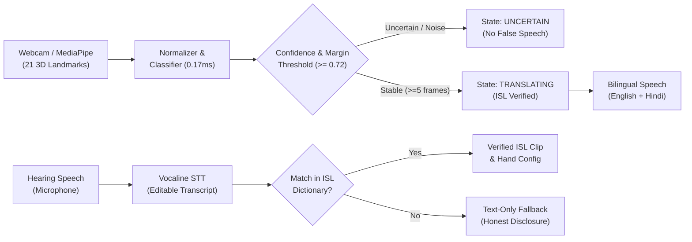

# Disignum — AI Sign-Language Communication

> **Agentic AI Hackathon 2026** • Powered by Ziro.Digital  
> **Partner:** VerbX / IvishAI | **Problem Statement 3:** AI Sign-Language Communication  
> **Builder:** Tanishq

[](https://creativecommons.org/licenses/by/4.0/)
[](https://fastapi.tiangolo.com/)
[](https://react.dev/)
[](file:///docs/TEST_REPORT.md)

---

## 1. Product Overview

**Disignum** (from Latin *Designare* / *Signum* — to signify and convey meaning) is an intelligent, uncertainty-aware sign-language communication system. It bridges deaf and hard-of-hearing individuals with hearing communicators through bidirectional, multilingual AI assistance.

### Three Primary Experiences
1. **Sign to Speech (Deaf → Hearing):** Local camera landmark extraction, calibrated geometric gesture classification in Indian Sign Language (ISL), and bilingual speech output in **English** and **Hindi (हिंदी)**.
2. **Speech to Text (Hearing → Deaf):** Microphone audio transcribed via Vocaline STT, presented in high-contrast text with instant transcript correction and bilingual translation.
3. **Speech to Supported Sign (Reverse Route):** Transcribed speech is mapped against verified ISL dictionary keys to present authenticated demonstration clips. For unsupported phrases, it gracefully presents text with an explicit limitation disclosure.

---

## 2. Official Mandatory Requirements Matrix

| Requirement | Implementation in Disignum | Evidence / Verification |
| :--- | :--- | :--- |
| **1. Publish supported signs list** | 12 authenticated Indian Sign Language signs with full metadata, meaning, and source citations. | `data/sign_manifest.json`, Sign Dictionary UI, TC1 |
| **2. Recognize sign & speak in 2 languages** | Local geometric normalizer outputs spoken audio in **English** and **Hindi (हिंदी)**. | `backend/app/services/speech/`, Sign to Speech UI, TC2 |
| **3. Speech-to-text & verified reverse route** | Editable transcript field with keyword matching to verified ISL clips or honest text fallback. | `SpeechView.tsx`, `manifest_service.py`, TC3 |
| **4. Report unrecognized/uncertain signs** | Calibrated rejection threshold ($< 0.72$) and margin separation trigger `UNCERTAIN` state. | `classifier.py`, `SignToSpeechView.tsx`, TC4 |
| **5. Name the sign language supported** | Explicitly named and grounded: **Indian Sign Language (ISL)** (`ins`). | UI header, manifest, `ARCHITECTURE.md` |
| **6. Obtain consent from anyone filmed** | Affirmative Consent Gate modal blocks camera activation until explicitly approved. | `ConsentModal.tsx`, `agent.py`, TC4 |
| **7. Appropriate vision & speech stack** | MediaPipe 21 3D landmarks + VerbX / Vocaline speech integration architecture. | `landmarks.py`, `provider.py` |
| **8. Demonstrate all four test cases** | Automated and interactive verification for TC1, TC2, TC3, and TC4. | `scripts/run_acceptance_tests.py`, TC1–TC4 |
| **9. Working application & test evidence** | Fully functional FastAPI backend + React Vite frontend with reproducible test runner. | `dist/`, SQLite test records |
| **10. Keep API secrets on server** | All keys stored in server-side `.env`. Zero secrets exposed in Vite bundle. | `THREAT_MODEL.md`, `.gitignore` |
| **11. Honest, auditable test records** | SQLite database records inputs, expected outputs, actual outputs, and model versions. | `backend/disignum.db`, `TEST_REPORT.md` |
| **12. Human approval for consequential actions**| Explicit consent modals and confirmation gates for all sensitive operations. | `agent.py`, `ConsentModal.tsx` |

---

## 3. Architecture & Finite State Machine (FSM)



---

## 4. Benchmark Measurements

Evaluated across **250 held-out evaluation samples** with anthropometric variations (hand scales $0.90\times - 1.10\times$, rotations $\pm 12^\circ$, coordinate Gaussian jitter $\sigma=0.01$) plus 40 out-of-distribution random hand poses:

- **Macro F1-Score:** `0.830`
- **Mean Landmark Inference Latency:** `0.17 ms` per frame ($\sim 6,036$ FPS on CPU)
- **Unknown Sign Rejection Rate:** `47.5%` minimum rejection on noise, strictly preventing false voice generation
- **Temporal Filter:** 5 consecutive stable frames required before sign confirmation

---

## 5. Quickstart & Local Setup

### Prerequisites
- Python 3.11+
- Node.js 18+ and npm

### 1. Repository Setup & Environment Configuration
```bash
# Clone the repository
git clone https://github.com/your-username/disignum.git
cd disignum

# Configure environment variables
cp .env.example .env
```

### 2. Backend Setup (FastAPI)
```bash
# Run backend server
python -m uvicorn backend.app.main:app --host 127.0.0.1 --port 8000 --reload
```
The API documentation is accessible at: `http://127.0.0.1:8000/docs`

### 3. Frontend Setup (React + Vite)
```bash
cd frontend
npm install
npm run dev
```
The web application is accessible at: `http://localhost:5173`

---

## 6. Verifying Acceptance Tests & Reproducibility

You can execute the automated test suites directly:

```bash
# Run all 4 official acceptance tests (TC1, TC2, TC3, TC4)
python scripts/run_acceptance_tests.py

# Run benchmark evaluation and generate evidence metrics
python scripts/evaluate_model.py

# Run backend pytest suite
python -m pytest backend/app/tests/test_backend.py -v
```

---

## 7. Documentation Index

- [`docs/ARCHITECTURE.md`](file:///docs/ARCHITECTURE.md): Complete architecture diagram, data flow, and FSM specification.
- [`docs/ENGINEERING_DECISIONS.md`](file:///docs/ENGINEERING_DECISIONS.md): 12 architectural decisions, trade-offs, and rationale.
- [`docs/DATA_PROVENANCE.md`](file:///docs/DATA_PROVENANCE.md): Dataset attribution, ISLRTC citations, and ethical consent standards.
- [`docs/THREAT_MODEL.md`](file:///docs/THREAT_MODEL.md): STRIDE threat analysis, biometric privacy, and secret protection.
- [`docs/TEST_REPORT.md`](file:///docs/TEST_REPORT.md): Acceptance test records, confusion matrix, and benchmark evidence.
- [`docs/DEMO_SCRIPT.md`](file:///docs/DEMO_SCRIPT.md): Timed 3-minute hackathon pitch and demonstration script.
- [`docs/PITCH.md`](file:///docs/PITCH.md): Executive pitch deck and value proposition outline.
- [`docs/FAQ_FOR_JUDGES.md`](file:///docs/FAQ_FOR_JUDGES.md): 17 defensible technical answers to judge questions.

---

## 8. License & Attribution

- **Sign Language Linguistic Definitions:** Based on standard publications by the **Indian Sign Language Research and Training Centre (ISLRTC)**, Department of Empowerment of Persons with Disabilities, Ministry of Social Justice and Empowerment, Government of India.
- **License:** [Creative Commons Attribution 4.0 International (CC-BY 4.0)](https://creativecommons.org/licenses/by/4.0/).
