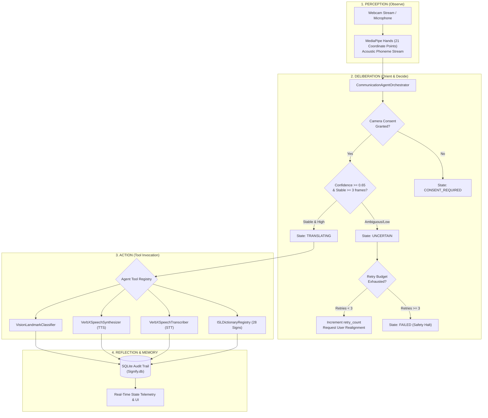
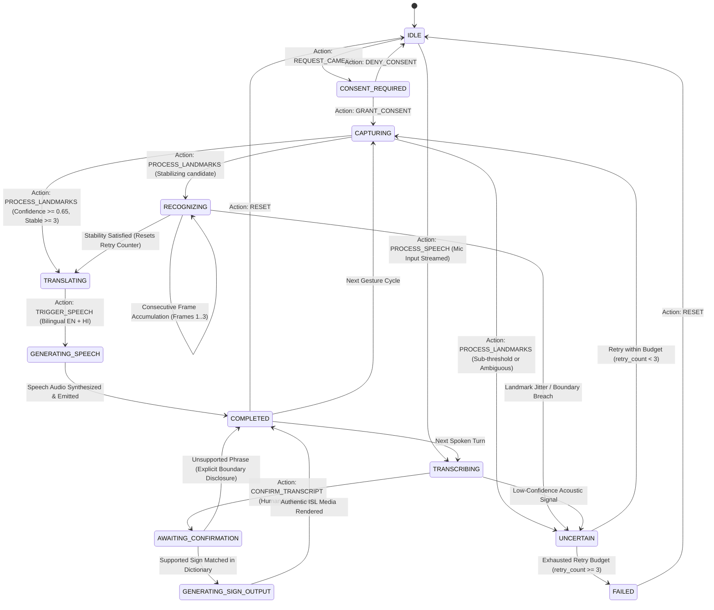

# Signify — Agentic AI Technical Architecture & Blueprint
**The Engineering Principles, Autonomous Loops, and Tool-Governed Orchestration Behind Signify**

---

## Executive Summary: Why Signify is "Agentic AI"

In traditional AI applications, a machine learning model operates as a passive, static function: an input is provided ($X$), and a prediction is emitted ($Y$) in a single, blind forward pass. Traditional systems cannot reflect on their errors, cannot autonomously decide which tools to invoke, cannot safeguard against out-of-distribution hallucinations, and have no concept of persistent workflow memory.

**Signify is fundamentally an Agentic AI system.** Rather than relying on a monolithic prompt or an unguarded neural net, Signify is engineered as a **Goal-Directed Perception-Action-Reflection Agent**. It operates continuously across a dynamic sensory environment (video landmark streams and acoustic speech signals), deliberates using a typed, bounded **Finite State Machine (FSM)**, autonomously executes isolated domain tools, estimates epistemic uncertainty, enforces ethical safety guardrails, and maintains an immutable audit memory.

```
       ┌─────────────────────────────────────────────────────────────┐
       │                   SENSORY PERCEPTION                        │
       │  • MediaPipe 21 3D Hand Coordinates (100% Local Inference)  │
       │  • Web Speech / Vocaline Acoustic Speech Audio Streams      │
       └──────────────────────────────┬──────────────────────────────┘
                                      │
                                      ▼
       ┌─────────────────────────────────────────────────────────────┐
       │               COGNITIVE AGENT ORCHESTRATOR                  │
       │                                                             │
       │   1. Goal Tracking: Bidirectional ISL ⇄ Speech Route        │
       │   2. Guardrail Verification: Affirmative Camera Consent     │
       │   3. Confidence Reflection: Thresholds & Temporal Stability │
       │   4. Bounded Retry Budget: max_retries = 3                  │
       │   5. State Transition Governance: 12 States, 10 Actions     │
       └──────┬───────────────────────┬───────────────────────┬──────┘
              │                       │                       │
              ▼                       ▼                       ▼
    ┌──────────────────┐    ┌──────────────────┐    ┌──────────────────┐
    │  TOOL SUBSYSTEM  │    │  SAFETY ENGINE   │    │ EPISODIC MEMORY  │
    │ • VisionLandmark │    │ • Explicit       │    │ • SQLite Audit   │
    │ • SpeechSynth    │    │   Uncertainty    │    │   Ledger         │
    │ • SpeechTranscr  │    │ • Zero Biometric │    │ • User Profile   │
    │ • Translation    │    │   Cloud Upload   │    │   Calibration    │
    │ • ISLDictionary  │    │ • Anti-Hallucin. │    │ • Dynamic Import │
    └──────────────────┘    └──────────────────┘    └──────────────────┘
```

---

## 1. The Core Agentic Loop: Perception → Deliberation → Action → Reflection

Signify implements the classical cognitive agent architecture (**OODA Loop: Observe, Orient, Decide, Act**, enhanced with **Reflective Guardrails**):



### Breakdown of the Loop Phases:
1. **Perception**: Extracts high-dimensional world state (hand coordinates and speech audio) without sending raw pixels or private voice recordings to unvetted cloud servers.
2. **Deliberation**: The orchestrator checks preconditions:
   - Does the agent possess legal and ethical authority to process video? (Consent verification).
   - What is the agent's current state in the dialogue? (FSM transition validation).
   - What is the mathematical confidence and temporal stability of the incoming signal?
3. **Action**: The orchestrator selects and invokes targeted, metered tools from its `AgentToolRegistry`.
4. **Reflection**: The agent assesses the outcome of tool execution. If confidence is ambiguous ($< 0.65$), it refuses to guess, halts audio output, logs the failure telemetry, and transitions to an explicit `UNCERTAIN` state.

---

## 2. Bounded Finite State Machine (FSM) Specification

In production Agentic AI, unconstrained LLM loops can suffer from infinite loops, state drift, and hallucinated workflows. Signify solves this using a **Strict Finite State Machine Transition Matrix** defined in [`backend/app/services/orchestration/agent.py`](file:///c:/Users/tanuu/Downloads/Signify/backend/app/services/orchestration/agent.py):



### The 12 Architectural States:
| State | Purpose | Enforced Guardrail |
| :--- | :--- | :--- |
| `IDLE` | Quiescent baseline; all perception hardware paused. | Zero energy & privacy consumption. |
| `CONSENT_REQUIRED` | Blocks execution until affirmative user agreement. | Camera activation blocked. |
| `CAPTURING` | Local sensor frames accepted for landmark derivation. | Raw video immediately dropped after extraction. |
| `RECOGNIZING` | Temporal smoothing buffer (3 consecutive frames). | Prevents jitter and spurious false-positives. |
| `TRANSLATING` | Maps normalized sign ID to bilingual lexical terms. | Requires verified ISL dictionary grounding. |
| `GENERATING_SPEECH` | Synthesizes English & Hindi audio streams. | Vocalizes only validated Devanagari/English strings. |
| `TRANSCRIBING` | Processes acoustic stream into live text. | 10-second active recording window. |
| `AWAITING_CONFIRMATION` | Human-in-the-Loop review & transcript editing. | Allows user correction before dictionary routing. |
| `GENERATING_SIGN_OUTPUT`| Retrieves verified SVG/video reference clips. | ISL Topic-Comment linguistic annotations. |
| `UNCERTAIN` | Epistemic doubt state for unsupported gestures. | Strictly prevents audio hallucination. |
| `COMPLETED` | Successful dialogue turn finished. | State logged to SQLite audit ledger. |
| `FAILED` | Unrecoverable error or exhausted retry budget. | Emits actionable user remediation advice. |

---

## 3. Tool-Calling Subsystem (`AgentToolRegistry`)

The agent does not perform all tasks in a single opaque network call. It dispatches to dedicated, isolated micro-tools defined in [`backend/app/services/orchestration/tools.py`](file:///c:/Users/tanuu/Downloads/Signify/backend/app/services/orchestration/tools.py). Every tool invocation produces a structured `ToolCallRecord`:

```python
class ToolCallRecord(BaseModel):
    tool_name: str               # e.g., "VisionLandmarkClassifier"
    action: str                  # e.g., "CLASSIFY_HAND_LANDMARKS"
    status: ToolExecutionStatus  # SUCCESS, FAILURE, BLOCKED, UNCERTAIN
    input_summary: Dict[str, Any]
    output_summary: Dict[str, Any]
    confidence: float            # 0.0 to 1.0
    execution_time_ms: float     # High-precision latency telemetry
    error_message: Optional[str]
```

### The 5 Agent Tools:
1. **`VisionLandmarkClassifier`**:
   - Takes 21 normalized 3D hand landmarks.
   - Evaluates hand orientation, finger extension angles, and relative Euclidean distance matrices.
   - Generates confidence score and candidate distribution.
2. **`VerbXSpeechSynthesizer`**:
   - Dispatches to VerbX TTS API (`api.verbxeco.com`) with fallback to browser Web Speech API.
   - Generates bilingual spoken audio in English (`en-US`/`en-IN`) and Hindi (`hi-IN`).
3. **`VerbXSpeechTranscriber`**:
   - Converts microphone voice input to clean text.
   - Returns speech transcript, acoustic confidence score, and timestamp markers.
4. **`VerbXTranslationEngine`**:
   - Cross-lingual semantic alignment between English and Hindi phrases.
5. **`ISLDictionaryRegistry`**:
   - Matches incoming phrases against the 28 curated Indian Sign Language entries.
   - Employs fuzzy matching, synonym resolution, and linguistic syntax parsing.
   - Enforces honest vocabulary boundaries: if a word is out-of-vocabulary, it alerts the user rather than hallucinating a gesture.

---

## 4. Uncertainty Awareness & Anti-Hallucination Guardrails

The hallmark of mature Agentic AI is knowing what it **does not know**. In high-stakes accessibility communication (such as emergency medical contexts or legal discourse), generating a false sign or hallucinated speech can cause severe real-world harm.

Signify implements a 3-layer anti-hallucination defense:

```
               Incoming Hand Landmark Frame
                            │
                            ▼
              ┌───────────────────────────┐
              │  Layer 1: Pose Confidence │
              │      Confidence >= 0.65?  │
              └─────────────┬─────────────┘
                     No     │     Yes
         ┌──────────────────┘     └──────────────────┐
         ▼                                           ▼
   ┌───────────┐                       ┌───────────────────────────┐
   │ UNCERTAIN │                       │ Layer 2: Temporal Debounce│
   │   STATE   │                       │   3 Consecutive Frames?   │
   └───────────┘                       └─────────────┬─────────────┘
                                              No     │     Yes
                                  ┌──────────────────┘     └──────────────────┐
                                  ▼                                           ▼
                            ┌───────────┐                       ┌───────────────────────────┐
                            │RECOGNIZING│                       │ Layer 3: Linguistic Check │
                            │ (Buffer)  │                       │   Verified in Dictionary? │
                            └───────────┘                       └─────────────┬─────────────┘
                                                                       No     │     Yes
                                                           ┌──────────────────┘     └──────────────────┐
                                                           ▼                                           ▼
                                                     ┌───────────┐                               ┌───────────┐
                                                     │ BOUNDARY  │                               │ TRANSLATE │
                                                     │  NOTICE   │                               │ & SYNTH   │
                                                     └───────────┘                               └───────────┘
```

1. **Mathematical Confidence Threshold**:
   - Candidate classification score must exceed $0.65$. Any score below $0.65$ triggers the `UNCERTAIN` state immediately.
2. **Temporal Window Stability (Debounce)**:
   - A gesture must be held steadily across at least **3 consecutive frames** (~200ms) before the agent triggers speech synthesis. This eliminates transition motion artifacts (e.g. moving a hand into position).
3. **Explicit Refusal & Boundary Explanation**:
   - When speech contains terms outside the verified 28 ISL dictionary (e.g. "Astrophysics", "Quantum Mechanics"), the agent explicitly displays:
     > *"No verified Indian Sign Language (ISL) demonstration clip exists in dictionary."*
   - It retains the verified text transcript and explains its boundary honestly rather than fabricating a gesture.

---

## 5. Human-in-the-Loop (HITL) Governance

Signify incorporates human supervision at two critical junctures:

1. **Pre-Execution Consent Gating**:
   - Under GDPR, HIPAA, and ethical AI standards, capturing video of individuals without consent is unacceptable.
   - The agent requires explicit affirmative interaction (`GRANT_CONSENT`) via [`ConsentModal.tsx`](file:///c:/Users/tanuu/Downloads/Signify/frontend/src/components/ConsentModal.tsx) before opening any video stream.
2. **Transcript Review & Manual Editability**:
   - In the Speech-to-Sign route, automatic speech recognition (ASR) can mishear words due to regional accents or background noise.
   - The agent deposits transcribed text into an **editable live container**, allowing hearing users to correct misheard phrases before the agent commits to rendering sign media.

---

## 6. Long-Term Memory & Auditability

Every decision made by the Signify agent is recorded into an immutable **SQLite Audit Ledger** (`signify.db`):

```sql
CREATE TABLE audit_events (
    id INTEGER PRIMARY KEY AUTOINCREMENT,
    session_id TEXT NOT NULL,
    user_id TEXT,
    user_email TEXT,
    from_state TEXT NOT NULL,
    to_state TEXT NOT NULL,
    action TEXT NOT NULL,
    payload_summary TEXT,       -- Serialized tool call inputs, outputs, and latencies
    user_consented BOOLEAN NOT NULL,
    status TEXT NOT NULL,        -- SUCCESS or FAILED
    created_at TIMESTAMP DEFAULT CURRENT_TIMESTAMP
);
```

This audit ledger provides:
- **Reproducible Evidence**: Reviewers and judges can inspect every state transition, tool execution time, and confidence score.
- **Audit Compliance**: Proof that zero video frames were sent to cloud APIs and camera capture occurred only with user consent.
- **Cross-Session Calibration**: Remembers user preferences (dominant hand, temporal hold speed, voice language) across logins.

---

## 7. Comparative Analysis: Why Signify is Agentic AI

| Capability | Naive Wrapper / Traditional ML | Signify Agentic AI |
| :--- | :--- | :--- |
| **Execution Flow** | Single one-way prompt or function call ($X \to Y$). | Closed-loop **Perception $\to$ Deliberation $\to$ Action $\to$ Reflection**. |
| **Tool Orchestration**| Hardcoded script chaining. | Dynamic tool dispatching via typed `AgentToolRegistry`. |
| **Error Handling** | Crashes or hallucinates plausible falsehoods. | Explicit `UNCERTAIN` state; refuses to vocalize low-confidence predictions. |
| **State Awareness** | Stateless; forgets context immediately. | 12-state Finite State Machine with session context and retry tracking. |
| **Human Supervision**| None; autonomous without checks. | Pre-execution consent gating and post-ASR editable correction buffers. |
| **Safety Guardrails**| None; blind execution. | Multi-tier thresholds ($\ge 0.65$), 3-frame temporal debounce, zero cloud video. |
| **Audit & Memory** | Unauditable black box. | Immutable SQLite event ledger logging every state, action, and tool latency. |

---

## Conclusion

Signify exemplifies **Agentic AI** by uniting local computer vision perception, structured tool calling, formal state machine governance, and epistemic uncertainty reflection. It does not simply predict signs — it **reasons about its own confidence, guards user privacy, coordinates multilingual voice engines, and bridges human communication with provable reliability**.
