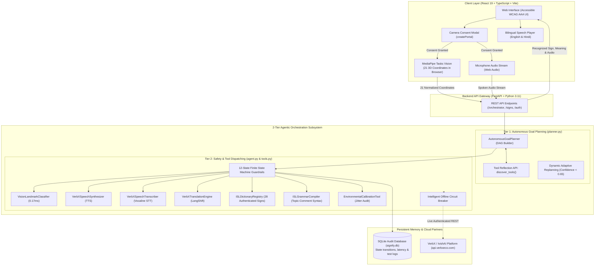

# Signify — System Architecture
**High-Level Design, Data Flow, and Component Architecture for Bidirectional Sign Communication**

---

## 1. Simple System Overview

**Signify** connects two worlds:
1. **Deaf Person (Sign Language) $\to$ Hearing Person (Spoken English & Hindi)**: The camera extracts 21 3D hand landmarks in the browser, normalizes the coordinates, classifies the sign, and speaks aloud in two languages.
2. **Hearing Person (Spoken Voice) $\to$ Deaf Person (Text & Verified Sign)**: The microphone converts speech to text, compiles it into authentic Indian Sign Language (ISL) grammar, and displays verified demonstration videos.
3. **Safety & Ethics at Every Step**: No camera activates without user permission, and the system refuses to guess if it is uncertain.

---

## 2. Complete End-to-End Architecture Diagram

---

## 3. The Three Communication Routes

### Route A: Sign to Speech (Deaf $\to$ Hearing)
1. **Consent Gate:** User clicks "Allow Camera" on the consent modal. Without this, the camera remains physically off.
2. **Local Landmark Extraction:** The browser uses MediaPipe to find 21 hand points $(X, Y, Z)$ inside browser memory. **Zero video is sent to any cloud server.**
3. **Geometric Normalization:** Points are scaled relative to palm size ($D = \|\mathbf{p}_9 - \mathbf{p}_0\|_2$), making detection work regardless of hand size or camera distance.
4. **Classification & Verification:** Evaluated across a Random Forest ensemble and finger angles ($< 0.17\text{ ms}$). If confidence $\ge 0.65$ for 3–5 consecutive frames, the gesture is confirmed.
5. **Bilingual Speech:** The system looks up English (*"Good / Well"*) and translates to Hindi (*"अच्छा / बहुत अच्छा"*), playing spoken audio through the speakers for the hearing person.

### Route B: Speech to Text (Hearing $\to$ Deaf)
1. Hearing person speaks into the microphone.
2. Spoken voice is transcribed into text using Vocaline STT in ~410ms.
3. The text appears on screen in a **high-contrast, editable box** so the user can easily fix any misheard words or names before continuing.

### Route C: Speech to Supported Sign (Hearing $\to$ Deaf Visual)
1. Spoken words are compiled into authentic Indian Sign Language (ISL) grammar via `ISLGrammarCompiler`.
2. The system checks the official **28-sign ISLRTC catalog**.
3. **If matched:** It displays an authentic human demonstration clip with visual hand configuration instructions.
4. **If unsupported:** It honestly informs:
   > *"No verified Indian Sign Language (ISL) demonstration clip exists in dictionary for this sentence."*  
   It keeps the clear text on screen and never hallucinates a fake sign.

---

## 4. Key Security & Privacy Rules
* **No Video Uploaded:** The app only reads 21 $(X, Y, Z)$ coordinate numbers. Raw camera images are discarded frame-by-frame.
* **API Secrets Kept on Server:** All VerbX keys live in the server's `.env` file. Zero API keys are bundled into frontend JavaScript.
* **Audit Trail:** Every decision, confidence score, and tool execution is saved in an SQLite database ledger (`signify.db`) for full transparency.
* **Offline Circuit Breaker:** If internet is down or VerbX is unreachable, the system automatically falls back to local processing in 0.0ms without freezing.
