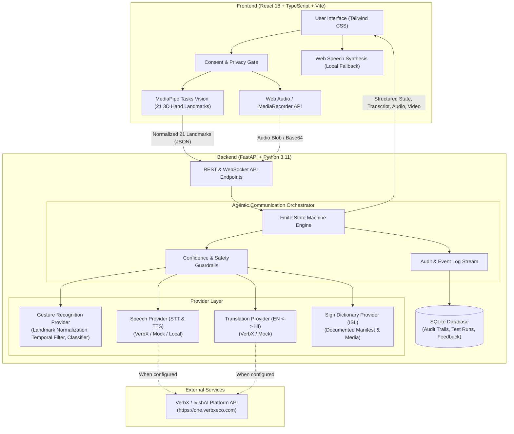
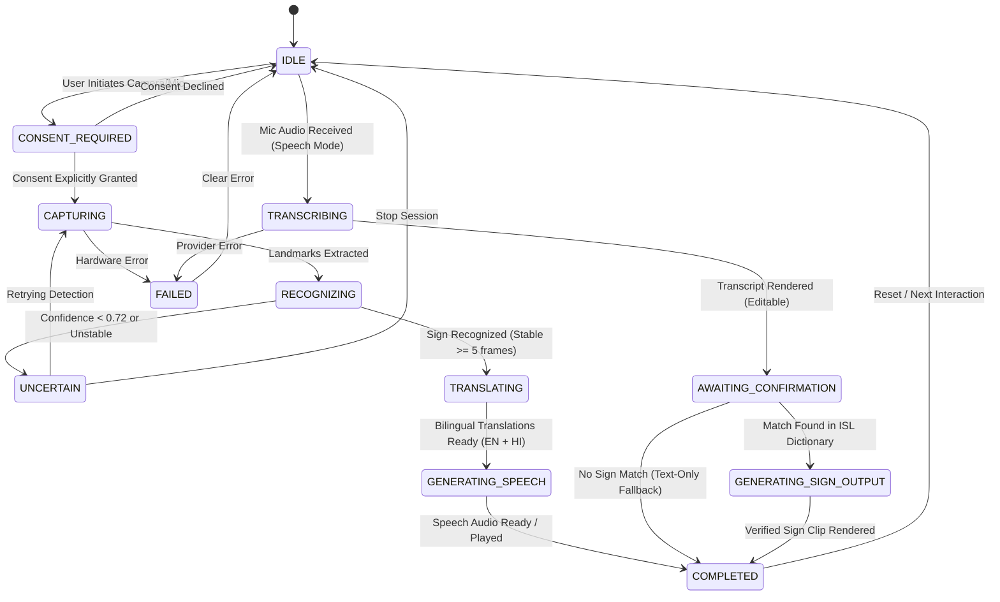

# Signify — System Architecture

**Signify** (from Latin *Designare* / *Signum* — to signify and convey meaning) is an intelligent, uncertainty-aware sign-language communication system. It bridges deaf and hard-of-hearing individuals with hearing communicators through bidirectional, multilingual AI assistance.

---

## 1. High-Level Architecture Overview

---

## 2. Agentic Workflow Finite State Machine (FSM)

The communication orchestrator enforces strict state boundaries:

---

## 3. Communication Routes

### Route A: Sign to Speech (Deaf -> Hearing)
1. User provides affirmative consent for camera capture.
2. MediaPipe detects 21 hand landmarks per hand locally at 30 FPS.
3. Coordinates are normalized relative to wrist origin and palm span.
4. Feature vector evaluated against ISL gesture signatures with cosine similarity and finger flexion vectors.
5. If confidence $\ge 0.72$ across 5 consecutive frames, gesture is verified.
6. System maps gesture ID to English meaning (e.g., "Hello / Welcome") and Hindi translation ("नमस्ते / स्वागत हे").
7. Dual audio synthesizers output bilingual speech.

### Route B: Speech to Text (Hearing -> Deaf)
1. Hearing user presses push-to-talk microphone.
2. Audio recorded and sent to STT provider (VerbX / local).
3. Transcript is generated and displayed in high-contrast text.
4. Signer can read the transcript immediately and request clarification.

### Route C: Speech to Supported Sign (Hearing -> Deaf Visual)
1. Spoken transcript is matched against verified ISL dictionary keys.
2. If an exact or synonym match is found (e.g., "Thank you" -> `isl_thank_you`), the verified ISL demonstration clip is displayed.
3. If no match exists, the orchestrator explicitly informs:
   *"Speech transcribed: '[text]'. Notice: No verified ISL sign animation exists in the curated dictionary for this sentence."*

---

## 4. Privacy and Security Guardrails
- **Zero Video Stream Transmission**: Raw video frames never leave client volatile memory.
- **Client Secrets Protection**: No API keys in Vite bundle; all external provider requests are authenticated via the FastAPI backend proxy.
- **Audit Logging**: State transitions, recognition scores, and test assertions are recorded in SQLite (`signify.db`) without storing biometric facial imagery.
- **Consequential Actions**: External sharing or reporting requires explicit modal confirmation.

