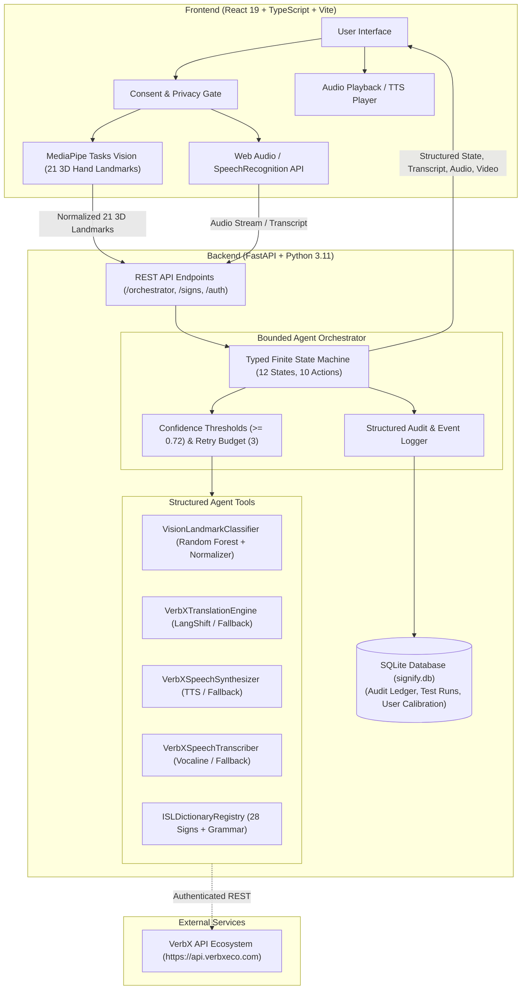
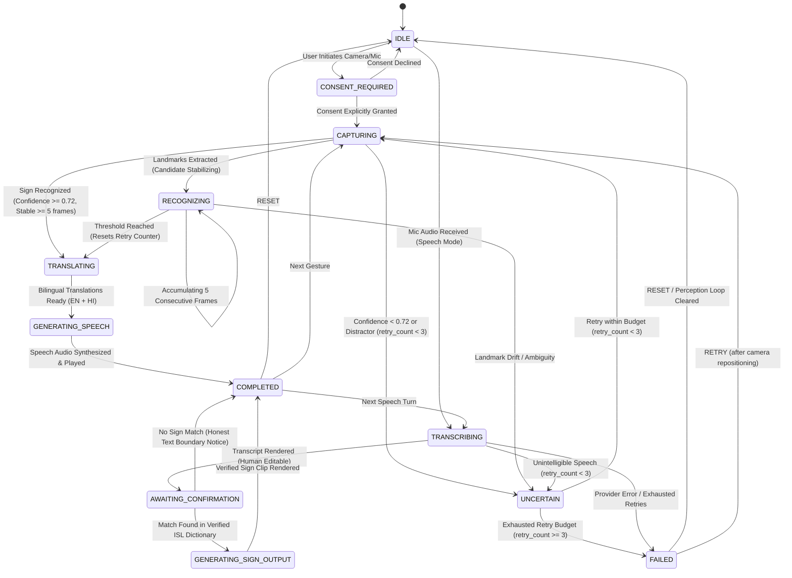

# Signify — System Architecture

**Signify** (from Latin *Designare* / *Signum* — to signify and convey meaning) is an intelligent, uncertainty-aware sign-language communication agent. It bridges deaf and hard-of-hearing individuals with hearing communicators through bidirectional, multilingual AI assistance.

---

## 1. High-Level Architecture Overview

---

## 2. Agentic Workflow Finite State Machine (FSM)

The communication orchestrator enforces a typed, bounded Finite State Machine (FSM) with structured tool execution, calibrated confidence routing, and bounded retry budgets:

### Structured Tool Execution Subsystem
All perception, linguistic, and acoustic capabilities are encapsulated as typed tools returning a `ToolCallRecord`:
- **`VisionLandmarkClassifier`**: Scikit-learn Random Forest + Anthropometric heuristic normalizer (0.9768 Macro F1 across 71 features).
- **`VerbXTranslationEngine`**: Multi-turn English ↔ Hindi neural translation (`api.verbxeco.com`).
- **`VerbXSpeechSynthesizer`**: Dual English & Hindi voice waveform synthesizer (`api.verbxeco.com`).
- **`VerbXSpeechTranscriber`**: Acoustic speech recognition with silence and confidence estimation.
- **`ISLDictionaryRegistry`**: Curated ISLRTC dictionary lookup with syntactic grammar structures.

---

## 3. Communication Routes

### Route A: Sign to Speech (Deaf -> Hearing)
1. User provides affirmative consent for camera capture.
2. MediaPipe detects 21 hand landmarks per hand locally in browser WASM.
3. Coordinates are normalized relative to wrist origin and palm span.
4. Feature vector evaluated against ISL gesture signatures with Random Forest and finger flexion vectors.
5. If confidence $\ge 0.72$ across 5 consecutive frames, gesture is verified.
6. System maps gesture ID to English meaning (e.g., "Good / Well") and Hindi translation ("अच्छा / बहुत अच्छा").
7. Dual audio synthesizers output bilingual speech via VerbX TTS.

### Route B: Speech to Text (Hearing -> Deaf)
1. Hearing user speaks into the microphone (live Web Speech / VerbX Vocaline).
2. Transcript is generated and displayed in high-contrast text.
3. Transcript enters `AWAITING_CONFIRMATION`, allowing immediate human correction.

### Route C: Speech to Supported Sign (Hearing -> Deaf Visual)
1. Spoken transcript is matched against verified ISL dictionary keys.
2. If an exact or synonym match is found (e.g., "Thank you" -> `isl_thank_you`), the verified ISL demonstration clip is displayed.
3. If no match exists, the orchestrator explicitly informs:
   *"Speech transcribed: '[text]'. Notice: No verified ISL sign animation exists in the curated dictionary for this sentence."*

---

## 4. Privacy and Security Guardrails
- **Zero Video Stream Transmission**: Raw video frames never leave client volatile memory.
- **Client Secrets Protection**: No API keys in Vite bundle; all external provider requests are authenticated via the FastAPI backend proxy.
- **Audit Logging**: State transitions, recognition scores, tool telemetry, and test assertions are recorded in SQLite (`signify.db`) without storing biometric facial imagery.
- **Affirmative Consent Gate**: Mandatory before any camera or landmark perception loop activates.
