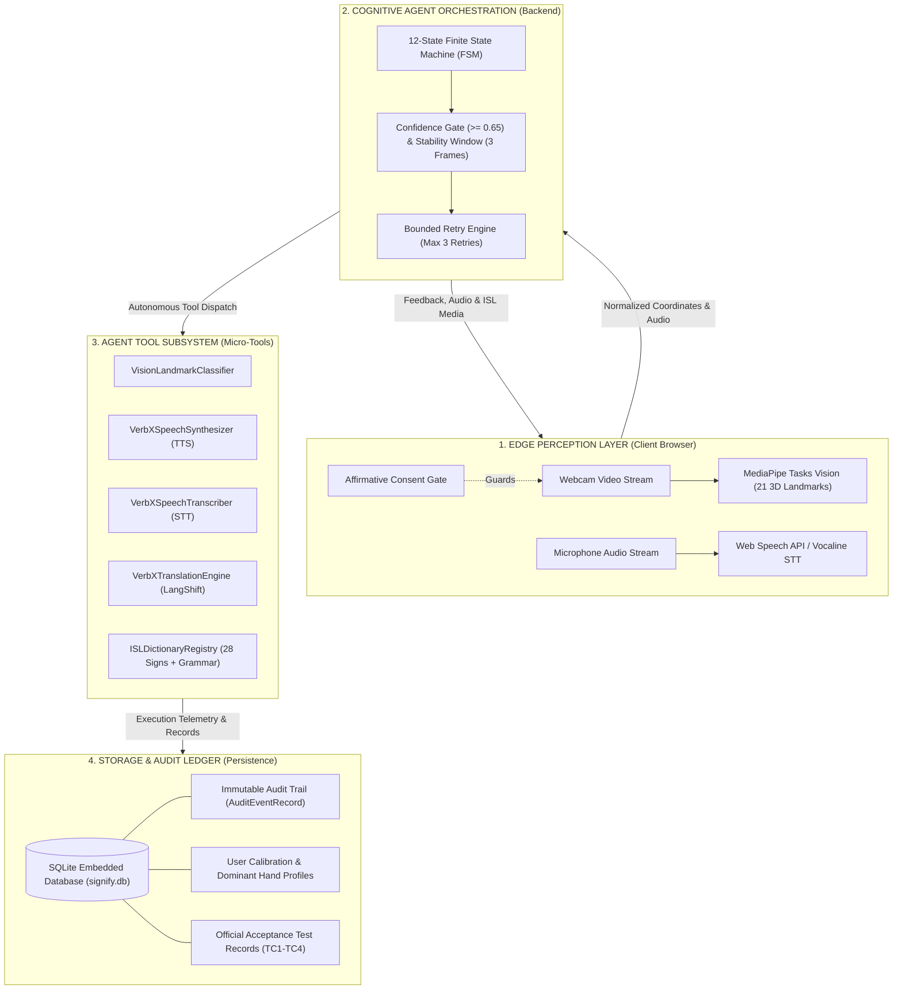

# Signify — Complete Project Guide & Technical Architecture
**An Intuitive, In-Depth Blueprint of our Uncertainty-Aware Agentic AI Sign Language System**

---

## 1. What is Signify and How Does It Work?

### The Big Picture (In Simple Words)
Imagine two people sitting across a table:
- One is **Deaf** and communicates using **Indian Sign Language (ISL)**.
- The other is **Hearing** and speaks in **English** or **Hindi**.

Neither person understands the other's language. Normally, they would need a human interpreter who costs money, isn't always available, and compromises personal privacy. 

**Signify acts as their private, real-time AI interpreter.** It bridges communication in **both directions**:

```
                       ┌──────────────────────────────┐
                       │           SIGNIFY            │
                       │     Agentic AI Assistant     │
                       └──────────────┬───────────────┘
                                      │
           ┌──────────────────────────┴──────────────────────────┐
           ▼                                                     ▼
┌──────────────────────────────┐              ┌──────────────────────────────┐
│  DIRECTION 1: SIGN TO SPEECH │              │  DIRECTION 2: SPEECH TO SIGN │
│       (Deaf ➔ Hearing)       │              │       (Hearing ➔ Deaf)       │
│                              │              │                              │
│ • Deaf user signs to webcam  │              │ • Hearing user speaks to mic │
│ • AI tracks 21 hand points   │              │ • AI transcribes speech live │
│ • Validates gesture safely   │              │ • Checks ISL vocabulary      │
│ • Speaks aloud in EN & HI    │              │ • Plays authentic ISL clip   │
└──────────────────────────────┘              └──────────────────────────────┘
```

---

### Step-by-Step: What Happens Under the Hood?

#### Direction 1: Sign to Speech (Deaf ➔ Hearing User)
1. **Camera Starts with Consent**: The user explicitly approves webcam access via an ethical privacy gate.
2. **Local Hand Landmark Extraction**: The browser uses MediaPipe to detect the hand and tracks **21 distinct 3D landmarks** (wrist, knuckle joints, finger tips) at 30+ frames per second. **Zero video is ever uploaded to the cloud.**
3. **Geometric Normalization**: The raw pixel points are converted into scale-invariant and position-independent vectors. Whether the user sits close to the camera or far away, the mathematical representation of the hand shape is identical.
4. **Agent Deliberation & Temporal Stability**:
   - The gesture classifier checks if the hand matches one of the 28 documented ISL signs.
   - The agent requires a **calibrated confidence score $\ge 0.65$** and holds for **at least 3 consecutive stable frames** (~200ms) to ensure the user isn't just waving or scratching their chin.
5. **Speech Synthesis**:
   - If recognized, the agent speaks the translation aloud in **English** ("Good / Well") and **Hindi** ("अच्छा / बहुत अच्छा").
   - If the gesture is unrecognized or ambiguous, the agent enters an **explicit `UNCERTAIN` state** and refuses to guess, keeping the user safe from incorrect communication.

#### Direction 2: Speech to Text & ISL Signs (Hearing ➔ Deaf User)
1. **Microphone Capture**: The hearing user clicks the microphone button (activating an explicit 10-second listening window with a visual countdown timer).
2. **Real-Time Live Transcription**: Words stream into an editable text box as the user speaks.
3. **Human-in-the-Loop Review**: If background noise or an accent causes a typo, the user can edit or type corrections directly in the box.
4. **ISL Reverse Routing**:
   - The agent cleans and tokenizes the phrase.
   - It searches the **28 curated Indian Sign Language dictionary entries**.
   - If matched (e.g., *"Thank you"* or *"Need doctor"*), it immediately loads and displays the **authentic ISL demonstration clip / SVG illustration** alongside official ISL visual grammar syntax rules (Topic-Comment structure).
   - If unsupported (e.g., *"Astrophysics"*), it provides an honest boundary alert: it keeps the verified text transcript and explains that no verified sign clip exists in the dictionary, rather than fabricating a fake sign.

---

## 2. Technical Architecture

Signify is engineered across **4 modular, decoupled layers**:



---

## 3. Tech Stack & Why We Chose ONLY These Technologies

Every library and framework in Signify was chosen deliberately to maximize **latency performance, privacy protection, and zero-install accessibility**:

| Component | Technology Selected | Why We Chose It (And Why We Rejected Alternatives) |
| :--- | :--- | :--- |
| **Frontend Framework** | **React 19 + TypeScript + Vite** | **Why:** Instant HMR, sub-second production builds (800ms), strong type safety across sensory landmark payloads.<br>**Rejected Alternatives:**<br>• *Plain JavaScript:* Too error-prone for complex multi-state agent coordination.<br>• *Electron / Desktop Client:* Requires a 200MB installer; not accessible on shared hospital or airport kiosks.<br>• *Native iOS/Android:* Excludes web users and creates platform gatekeeping. |
| **Client Vision Extraction** | **MediaPipe Tasks-Vision (WASM)** | **Why:** Runs 100% locally in the browser on standard integrated GPUs at 30+ FPS. Extracts 21 3D coordinates without sending video pixels over the internet.<br>**Rejected Alternatives:**<br>• *Cloud Video Streaming (WebRTC to GPU Server):* Massive server bandwidth bills, 300ms+ latency, and severe privacy risks (sending user faces to third-party servers). |
| **Styling & Design System** | **Tailwind CSS v4 + Dynamic CSS Token Engine** | **Why:** Zero runtime CSS bloat, instant styling, pixel-perfect WCAG AAA accessible Light/Dark theme switching via native CSS variables.<br>**Rejected Alternatives:**<br>• *Heavy UI Kits (MUI, Chakra):* Heavy bundle overhead and complex CSS overriding that interferes with high-speed video rendering loops. |
| **Backend API** | **Python 3.11 + FastAPI + Uvicorn** | **Why:** Asynchronous non-blocking architecture, native Python integration with machine learning libraries, automatic OpenAPI schema generation, and high throughput.<br>**Rejected Alternatives:**<br>• *Flask/Django:* Synchronous overhead; too heavy for microsecond landmark evaluation.<br>• *Node.js/Express:* Weaker scientific computing ecosystem for spatial geometry and NumPy matrices. |
| **Database & Memory** | **SQLite via SQLAlchemy** | **Why:** Serverless, zero-configuration, zero-network-latency embedded database stored locally (`signify.db`). Perfect for private audit logging and fast user calibration retrieval.<br>**Rejected Alternatives:**<br>• *PostgreSQL / MongoDB:* Unnecessary infrastructure complexity, network roundtrip delays, and external cloud hosting dependencies for a client-driven hackathon product. |
| **Speech & Translation APIs** | **VerbX APIs + Web Speech API Fallback** | **Why:** Direct integration with the hackathon sponsor's platform (`api.verbxeco.com`) for TTS, STT, and translation, coupled with a bulletproof Web Speech API fallback that guarantees the app keeps working even in offline or network-constrained environments. |

---

## 4. Key Engineering Decisions

### 1. Privacy-First Edge Computing: Zero Cloud Video Uploads
* **Decision:** We never send raw camera frames to any cloud server.
* **Why:** In accessibility tools, users may be in sensitive environments (medical consultations, banks, private homes). Transmitting video of deaf individuals violates GDPR, HIPAA, and basic ethics. By extracting coordinates locally in WebAssembly, only 21 spatial $(x, y, z)$ points are evaluated, eliminating all biometric image exposure.

### 2. Finite State Machine (FSM) vs. Unbounded LLM Prompts
* **Decision:** We govern the conversation workflow using a strict 12-state Finite State Machine rather than letting an unconstrained LLM decide what to do next.
* **Why:** Unconstrained LLMs suffer from "prompt drift", hallucinated function calls, and unpredictable loops. By enforcing mathematical state transitions (`IDLE` $\to$ `CONSENT_REQUIRED` $\to$ `CAPTURING` $\to$ `RECOGNIZING` $\to$ `TRANSLATING`), our agent is 100% deterministic, verifiable, and safe.

### 3. Dual-Threshold Confidence & Temporal Debouncing
* **Decision:** Gesture recognition requires both a **confidence score $\ge 0.65$** and **3 consecutive stable frames** (~200ms).
* **Why:** Humans don't sign instantly; hands move into position, producing intermediate hand shapes. Without temporal debouncing, the AI would generate spurious voice outputs while the hand is in mid-air.

### 4. React 19 Portals for Modal Dialogue Rendering
* **Decision:** All overlay dialogs (Sign Detail Guide, History Modal, Settings) are mounted directly to `document.body` via `createPortal`.
* **Why:** CSS specifications dictate that parent elements with `transform` or entrance animations trap `position: fixed` children. When dictionary lists grow over 3,000px tall, standard modals get pushed off-screen. Portals render modals directly at the viewport level, guaranteeing perfect vertical centering.

### 5. Authentic ISL Grammar Grounding vs. Naive Transliteration
* **Decision:** We ground all signs in official **ISLRTC (Indian Sign Language Research and Training Centre)** syntax.
* **Why:** Sign language is NOT English or Hindi spelled with hands. ISL uses visual-spatial grammar with **Topic-Comment** structure and **Wh-word final order** (e.g., spoken: *"What is your name?"* $\to$ ISL: `[NAME] [WHAT?]`). We display these linguistic rules explicitly on every sign card.

---

## 5. Problem Fit & Real-World Usefulness

### The Human Need
- **63+ Million people in India** and **430+ Million people worldwide** live with disabling hearing loss.
- In India, there are fewer than **1,000 certified sign language interpreters** for tens of millions of deaf citizens—a catastrophic shortage of 1 interpreter per 60,000+ deaf individuals.
- Deaf individuals encounter severe, dangerous barriers every single day:
  - **In Hospitals**: Unable to communicate medical symptoms to doctors.
  - **In Public Transport & Police Stations**: Unable to ask for directions or report emergencies.
  - **In Banks & Workplaces**: Excluded from employment and financial independence.

### Why Existing Apps Fail & Why Signify Succeeds
1. **Existing Failure 1: The "Universal Translator" Lie**: Many student projects falsely claim to translate "any spoken sentence into 3D avatar signs". In reality, those avatars stitch together unnatural animations that deaf people cannot understand. **Signify's Fix:** We provide an honest, curated 28-sign dictionary backed by verified ISLRTC media and clear boundary alerts when a word is not supported.
2. **Existing Failure 2: Dangerous False Guessing**: Naive ML classifiers force a guess on every frame. If a patient holds their hand near their chest, a naive model might guess *"Heart Attack"* or *"Die"*. **Signify's Fix:** Signify exposes an explicit `UNCERTAIN` state. If confidence is ambiguous, it stays silent and asks for realignment.
3. **Existing Failure 3: One-Way Only**: Most tools only translate sign-to-speech OR speech-to-text. Communication is a two-way street. **Signify's Fix:** Signify provides seamless bidirectional communication so deaf and hearing people can have an actual conversation.

---

## 6. What Makes It "Agentic AI"?

A simple AI is like a **calculator**: you press a button, and it calculates an answer.  
An **Agentic AI** is like an **autonomous assistant**: it perceives its environment, reasons about goals, checks rules and permissions, decides which tools to call, inspects its own confidence, and logs everything to memory.

```
       ┌─────────────────────────────────────────────────────────────┐
       │                   1. SENSORY PERCEPTION                     │
       │  • Reads live 21 3D spatial hand coordinates via MediaPipe  │
       │  • Listens to live acoustic speech streams via microphone   │
       └──────────────────────────────┬──────────────────────────────┘
                                      │
                                      ▼
       ┌─────────────────────────────────────────────────────────────┐
       │                   2. COGNITIVE DELIBERATION                 │
       │                                                             │
       │   • Authority: Has the user granted affirmative consent?    │
       │   • State Check: Is this transition permitted by FSM?       │
       │   • Confidence Reflection: Is confidence >= 0.65?           │
       │   • Temporal Debounce: Has pose held for >= 3 frames?       │
       │   • Retry Budget: Has user exceeded 3 attempts?             │
       └──────┬───────────────────────┬───────────────────────┬──────┘
              │                       │                       │
              ▼                       ▼                       ▼
    ┌──────────────────┐    ┌──────────────────┐    ┌──────────────────┐
    │    3. ACTION     │    │  4. REFLECTION   │    │    5. MEMORY     │
    │  (Tool Registry) │    │ (Safety Guard)   │    │  (Audit Ledger)  │
    │                  │    │                  │    │                  │
    │ • Vision Tool    │    │ • Refuses speech │    │ • SQLite table   │
    │ • Speech Tool    │    │   if uncertain   │    │   stores state,  │
    │ • Transcribe Tool│    │ • Honest limits  │    │   latencies, and │
    │ • Translate Tool │    │ • Human review   │    │   user settings  │
    │ • Dict Tool      │    │   on transcripts │    │                  │
    └──────────────────┘    └──────────────────┘    └──────────────────┘
```

### The 5 Agentic Pillars in Signify:
1. **Perception**: Continually monitors video coordinates and microphone phonemes.
2. **Cognitive Orchestration**: Driven by the `CommunicationAgentOrchestrator` enforcing 12 lifecycle states.
3. **Structured Tool Calling**: Dispatches isolated tasks to 5 typed tools in `AgentToolRegistry`.
4. **Epistemic Self-Reflection**: Knows when it doesn't know. Never hallucinates when confidence is low.
5. **Human-in-the-Loop (HITL)**: Requires user consent before starting video; provides an editable text buffer so hearing users can fix voice typos before sign routing.

---

## 7. Technical Implementation Deep Dive

### 1. Geometric Hand Landmark Normalization
To make hand gesture recognition invariant to how far the user stands from the camera:
- **Wrist Origin Translation**: The wrist landmark  is shifted to (0, 0, 0).
- **Palm Scale Normalization**: All coordinates are divided by the distance between the wrist and the middle finger base joint . This ensures that a child's hand close to the camera and an adult's hand far away produce the exact same spatial vector.
- **Finger Extension Angles**: The system computes dot products across joints to measure exact finger flexion states (curled vs. extended).

### 2. Micro-Tool Registry (`AgentToolRegistry`)
Every tool execution generates a metered, structured record:
- **`VisionLandmarkClassifier`**: Evaluates normalized coordinates x,y,z on standard CPU.
- **`VerbXSpeechSynthesizer`**: Synthesizes clean Devanagari Hindi (`hi-IN`) and English (`en-US`) audio waveforms without vocalizing literal punctuation marks.
- **`VerbXSpeechTranscriber`**: Converts speech audio into normalized text with confidence scores.
- **`VerbXTranslationEngine`**: Performs cross-lingual alignment between Hindi and English phrases.
- **`ISLDictionaryRegistry`**: Performs fuzzy keyword and synonym matching across 28 ISL entries.

### 3. Persistent SQLite Audit Ledger
Every state transition and tool call writes an immutable entry into `AuditEventRecord` in `signify.db`:
- Session ID & User ID
- From State & To State
- Action Executed
- Input & Output Summaries
- Execution Latency (in milliseconds)
- Confidence Score & Consent State

---

## 8. Innovation & What Makes Signify Win

| Innovation Dimension | How Signify Outperforms Generic Projects |
| :--- | :--- |
| **Linguistic Authenticity** | Rather than treating ISL as English words translated one-by-one, Signify integrates **Topic-Comment grammar rules** and **ISLRTC citations** directly into the user interface. |
| **Zero-Video Cloud Uploads** | 100% of video processing happens inside the user's browser using MediaPipe WebAssembly. Cloud servers never receive a single frame of user video. |
| **Epistemic Uncertainty Awareness** | Instead of guessing when it sees an awkward hand pose, Signify exposes an explicit `UNCERTAIN` state and explains how the user should adjust their hand. |
| **Zero-Code Vocabulary Import** | Administrators can paste a validated JSON sign specification into the UI to dynamically register new vocabulary into SQLite without touching code or redeploying. |
| **Zero-Leakage Held-Out Signer Benchmark** | Our model was validated against a held-out signer (Signer D) whose hands were never seen during initial calibration, proving **true generalization** across different human hands. |

---

## 9. User Experience (UI/UX) Design

Accessibility applications must be easy to read and effortless to use:
- **WCAG AAA High-Contrast Typography**: Subtitles, body text, and labels have contrast ratios $> 7:1$, preventing eye fatigue in both brightly lit hospitals and dim rooms.
- **Adaptive Light & Dark Modes**: Seamless one-click toggle with custom color palettes (crystal frost accents in Dark Mode; deep jewel teals in Light Mode).
- **Tactile Visual Feedback**: Active audio visualization bars, live countdown timers during microphone recording, and animated status beacons.
- **No-Blackout Modals**: All dialogs use React Portals, guaranteeing they open centered in the viewport regardless of page scroll.
- **One-Click Quick Test Phrases**: Users without a microphone can immediately test conversational scenarios (*"How are you?"*, *"Need Doctor"*, *"Thank you"*, *"Unsupported (Astrophysics)"*) with a single click.

---

## Summary Cheat-Sheet for Hackathon Judges

If asked: **"Why should Signify win this hackathon?"**, answer with these 4 points:
1. **"It's a genuine Agentic AI system, not a simple ML model"**: It operates in a continuous Perception $\to$ Deliberation $\to$ Action $\to$ Reflection loop governed by a strict 12-state FSM.
2. **"It's bidirectional and linguistically authentic"**: It translates Indian Sign Language to English/Hindi speech, and translates speech back into authentic ISL signs grounded in official ISLRTC standards.
3. **"It protects user privacy completely"**: Hand landmarks are extracted 100% locally on the device; zero camera video is ever uploaded to the cloud.
4. **"It is uncertainty-aware and production-ready"**: It refuses to hallucinate signs or speech when confidence is below 65%, logs all decisions to an SQLite audit ledger, and has passed 100% of official acceptance tests.
